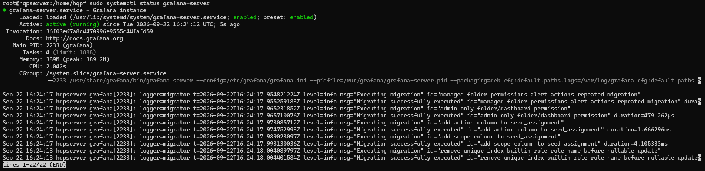
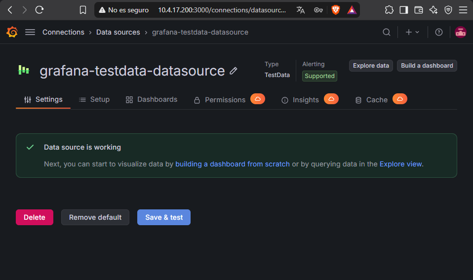
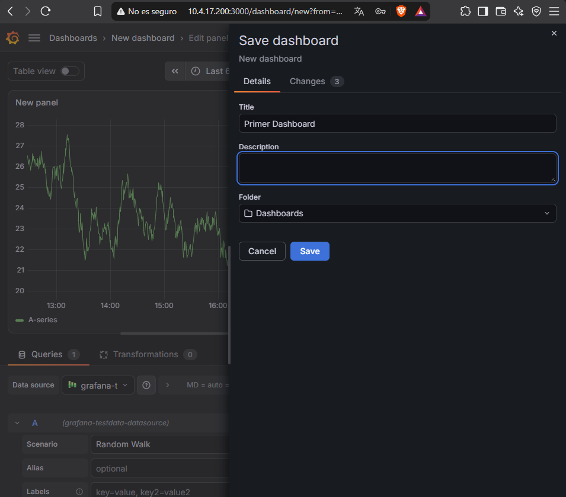

# Grafana en Ubuntu Server

Instalación de **Grafana OSS** desde su repositorio oficial en un Ubuntu Server virtualizado, administrado por SSH desde Windows, y creación de un primer dashboard con la fuente de datos de prueba **TestData**.

Práctica de *Administración de Sistemas Operativos* (2º ASIR).

## Arquitectura

```
Windows (anfitrión) ── SSH (22) / navegador (3000) ──> Ubuntu Server en VirtualBox (adaptador puente)
                                                         └── grafana-server (systemd)
```

## Instalación

El script [`install.sh`](install.sh) recoge los pasos:

1. Añadir la clave GPG y el repositorio `apt.grafana.com`.
2. Instalar el paquete `grafana`.
3. Habilitar y arrancar `grafana-server` con systemd.

```bash
./install.sh
```

Acceso en `http://IP_DEL_SERVIDOR:3000`. En el primer inicio Grafana pide cambiar la contraseña del usuario `admin`.

## Primer dashboard

1. *Connections > Data sources > Add data source > TestData* y **Save & test**.
2. *Dashboards > New dashboard > Add visualization*, con TestData como fuente (serie aleatoria).
3. Guardar el dashboard.

## Evidencias

| | |
|---|---|
|  |  |
| `grafana-server` activo | Acceso web desde Windows |
|  |  |
| Fuente de datos funcionando | Guardado del primer dashboard |

## Siguiente paso

Conectar Grafana a métricas reales instalando **Prometheus** y **node_exporter** en el servidor, para visualizar CPU, memoria, disco y red.
